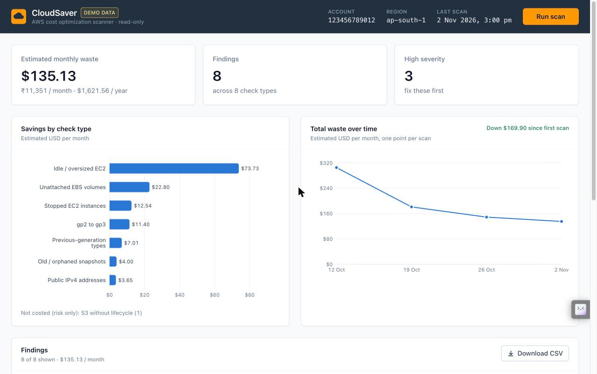

# CloudSaver – AWS Cost Optimization Scanner & Dashboard

**A read-only scanner that finds wasted and over-provisioned AWS resources, estimates what each one costs per month, and tells you exactly how to fix it.** Same idea as AWS Trusted Advisor / Compute Optimizer, kept simple.


<!-- Demo-mode screenshot. Replace docs/screenshot.jpg with one from your own account scan. -->

---

## Architecture

```
 ┌──────────────────────────┐        ┌───────────────────────────────┐
 │  Dashboard (React/Vite)  │  HTTP  │   Express API (Node + TS)     │
 │  - summary cards         │ ─────▶ │   POST /api/scan              │
 │  - charts (Recharts)     │  /api  │   GET  /api/scans[/:id]       │
 │  - findings table / CSV  │ ◀───── │   GET  /api/scans/:id/report.csv
 └──────────────────────────┘        └───────────────┬───────────────┘
                                                     │ scanner.ts
                                                     │ Promise.allSettled(9 checks × regions)
                                                     ▼
                                     ┌───────────────────────────────┐
                                     │  AWS SDK for JavaScript v3    │
                                     │  (default credential chain,   │
                                     │   read-only Describe/Get/List)│
                                     └──┬──────────┬─────────┬───────┬┘
                                        ▼          ▼         ▼       ▼
                                      EC2 /      CloudWatch   S3     STS
                                      EBS / EIP  (CPU 7d)  (lifecycle) (account id)
                                                     │
                                                     ▼
                                     data/scans/<timestamp>.json  (no database)
```

- **Read-only by design.** The code only imports `Describe*`, `Get*` and `List*` commands. Fix commands are shown for a human to review and copy; CloudSaver never runs them.
- **One failed check does not kill the scan.** Checks run in parallel with `Promise.allSettled`; a missing permission shows up as a warning for that check only.
- **No paid APIs.** Prices come from a static table (`backend/src/pricing.ts`, ap-south-1). Cost Explorer is not used because it charges $0.01 per request.

## The checks

| # | Check | What it finds | Why it costs money | How to fix |
|---|---|---|---|---|
| 1 | Unattached EBS volumes | Volumes in `available` state | EBS bills per GB-month whether or not anything is attached | Snapshot (if needed), then `delete-volume` |
| 2 | Old / orphaned snapshots | Snapshots older than 30 days, or whose source volume is deleted | Snapshot storage is billed per GB-month forever | Delete, or move to Snapshot Archive; automate with Data Lifecycle Manager |
| 3 | Unassociated Elastic IPs | EIPs not attached to anything | Every public IPv4 costs $0.005/hr ($3.65/month) | `release-address` |
| 4 | Stopped EC2 instances | Instances in `stopped` state | Compute stops, but attached EBS volumes are still billed | Create an AMI, terminate; or keep only if used regularly |
| 5 | Idle / oversized EC2 | Running instances with average CPU < 10% over 7 days (CloudWatch) | Paying for capacity you don't use | Right-size one step down (e.g. t3.medium → t3.small), shows the price difference |
| 6 | Previous-generation types | t2, m4, c4, r4, m3, c3… | Older families cost more for less performance | Move to t3/m5/c5/r5, or Graviton (t4g/m6g/c6g) for ~20% less |
| 7 | gp2 volumes | In-use `gp2` volumes | gp3 is ~20% cheaper per GB with better baseline performance | `modify-volume --volume-type gp3` (online, no downtime) |
| 8 | S3 without lifecycle | Buckets with no lifecycle rules, or versioned buckets that never expire old versions | Data stays in S3 Standard forever; old versions pile up silently | Lifecycle rule: Standard-IA at 30d, Glacier at 90d, expire noncurrent versions |
| 9 | Public IPv4 in use | Public IPs on network interfaces (auto-assigned or EIP) | Since Feb 2024, AWS bills every public IPv4 address, even in use | Use a load balancer / NAT / SSM Session Manager / IPv6; remove unneeded public IPs |

Every finding has the shape:
```ts
{ id, checkType, resourceId, resourceName, region, details, estimatedMonthlyCostUSD,
  severity: "high" | "medium" | "low", recommendation, awsCliFixCommand }
```

## Setup

### 1. Prerequisites
- Node.js 20+ (tested on 24) and npm
- AWS CLI v2 (only needed for `aws configure` and the demo-waste scripts): `brew install awscli`

### 2. Create a read-only IAM user (recommended) or role

The minimum policy is in [`iam/cloudsaver-readonly-policy.json`](iam/cloudsaver-readonly-policy.json): `ec2:Describe*`, `cloudwatch:GetMetricStatistics`, `cloudwatch:GetMetricData`, `s3:ListAllMyBuckets`, `s3:GetLifecycleConfiguration`, `s3:GetBucketLocation`, `s3:GetBucketVersioning`, `sts:GetCallerIdentity`. Nothing that can create, change or delete.

**Console:** IAM → Policies → Create policy → JSON → paste the file → name it `CloudSaverReadOnly`. Then IAM → Users → Create user `cloudsaver-readonly` (no console access) → Attach policies directly → `CloudSaverReadOnly` → Create. Open the user → Security credentials → Create access key → "Command Line Interface".

**CLI (run with an admin profile):**
```bash
aws iam create-policy --policy-name CloudSaverReadOnly \
  --policy-document file://iam/cloudsaver-readonly-policy.json
aws iam create-user --user-name cloudsaver-readonly
aws iam attach-user-policy --user-name cloudsaver-readonly \
  --policy-arn arn:aws:iam::<ACCOUNT_ID>:policy/CloudSaverReadOnly
aws iam create-access-key --user-name cloudsaver-readonly
```

**Role instead of user (EC2 / Lambda / SSO):** create a role with the same policy attached and run CloudSaver with that role. The SDK picks it up automatically through the default credential chain.

### 3. Configure credentials
```bash
aws configure --profile cloudsaver     # paste the read-only access key, region ap-south-1
export AWS_PROFILE=cloudsaver          # or put AWS_PROFILE=cloudsaver in .env
aws sts get-caller-identity            # should print your account id
```
Keys are never stored in this project. The AWS SDK reads them from the default credential chain (env vars, `AWS_PROFILE`, `~/.aws/credentials`, SSO, instance role).

### 4. Environment variables
```bash
cp .env.example .env
```
| Variable | Default | Meaning |
|---|---|---|
| `AWS_REGION` | `ap-south-1` | Region to scan |
| `AWS_PROFILE` | – | Which `aws configure` profile to use |
| `SCAN_ALL_REGIONS` | `false` | `true` = scan every region enabled for the account |
| `DEMO_MODE` | `false` | `true` = serve sample data from `data/demo-scan.json`, no AWS calls |
| `USD_TO_INR` | `84` | Fixed conversion rate for the ₹ figures |
| `IDLE_CPU_THRESHOLD` | `10` | Average CPU % below which an instance is "idle" |
| `SNAPSHOT_AGE_DAYS` | `30` | Snapshots older than this are flagged |
| `PORT` | `4000` | API port |

### 5. Run
```bash
npm install
npm run dev          # API on :4000, dashboard on http://localhost:5173
npm run dev:demo     # same, with DEMO_MODE=true (works offline)
npm run scan         # scan from the terminal, prints a table, saves JSON
npm test             # runs every check against stubbed AWS responses
npm run typecheck
```
If you change credentials while the app is running, restart `npm run dev`.

### 6. Optional: create real (tiny) waste to demo against
```bash
AWS_PROFILE=default ./scripts/create-demo-waste.sh    # 1 GB gp2 volume + its snapshot, tagged Project=CloudSaverDemo
# ... run a scan, see the finding ...
AWS_PROFILE=default ./scripts/cleanup-demo-waste.sh   # deletes ONLY resources with that tag
```
These scripts need write permissions, so use your admin profile, not the read-only user. They never create instances or Elastic IPs. Cost is a few cents per month.

## Project layout
```
backend/src/
  checks/          one file per check + index.ts registry
  aws/clients.ts   per-region SDK clients (adaptive retry for throttling)
  aws/errors.ts    turns AWS errors into clear messages (no credentials, access denied, throttling, network)
  scanner.ts       runs all checks with Promise.allSettled, totals per check type
  pricing.ts       static ap-south-1 price table
  storage.ts       JSON files in data/scans/, demo loader
  server.ts        Express API
frontend/src/      React dashboard (Tailwind, Recharts)
iam/               least-privilege policy
scripts/           demo waste create/cleanup, demo data generator
data/              demo-scan.json, scans/
```

## How AWS cost optimization works (simple English)

Most AWS waste comes from four things: **paying for things nobody uses**, **paying for bigger things than needed**, **paying full price for steady usage**, and **keeping data in the most expensive storage forever**.

**1. Delete idle resources.** The fastest wins. An unattached EBS volume, an Elastic IP nobody uses, a snapshot of a server deleted a year ago, a "temporary" instance left stopped for months. Each one is small, but across many accounts they add up. The fix is usually one command, plus a backup if unsure.

**2. Right-sizing.** Match the instance size to real usage. If a server averages 3% CPU for a week, it is probably 2–4× bigger than it needs to be. Each step down in size (xlarge → large) roughly halves the price. Check memory too: CPU alone does not tell the whole story (memory metrics need the CloudWatch agent). Compute Optimizer does this with ML; CloudSaver uses a simple CPU threshold.

**3. Modernize.** Newer instance generations (t2 → t3, m4 → m5) are cheaper *and* faster. Graviton (ARM) types like t4g/m6g are another ~20% cheaper if the software runs on ARM64.

**4. Commit for discounts on steady usage:**
| Option | What you commit to | Discount | Best for |
|---|---|---|---|
| **Reserved Instances** | A specific instance type/region for 1 or 3 years | up to ~72% | Very stable workloads that won't change type |
| **Savings Plans** | A $/hour spend for 1 or 3 years (Compute SP works across EC2, Fargate, Lambda, any region/family) | up to ~66–72% | Most steady workloads; more flexible than RIs |
| **Spot Instances** | Nothing; AWS can reclaim with 2 minutes' notice | up to ~90% | Batch jobs, CI, stateless workers, anything that can be interrupted |

Rule of thumb: right-size *first*, then commit. Committing to an oversized fleet locks in waste.

**5. gp2 → gp3.** gp3 is ~20% cheaper per GB and gives 3,000 IOPS / 125 MB/s baseline regardless of size (gp2 ties performance to size). The change is online with no downtime. For volumes over 1 TB, provision extra IOPS on gp3 to match gp2; CloudSaver includes that cost in its estimate.

**6. S3 lifecycle and storage classes.** S3 Standard is the most expensive class. Data that is rarely read should move automatically: Standard-IA (infrequent access) after 30 days, Glacier Instant/Flexible Retrieval or Deep Archive for archives, or Intelligent-Tiering when access patterns are unknown. On versioned buckets, expire old versions, or every overwrite is kept forever. Also abort incomplete multipart uploads: they are invisible in the console but billed.

**7. Public IPv4.** Since February 2024 every public IPv4 address costs $0.005/hour (~$3.65/month), in use or not. Fewer public IPs (load balancers, NAT, SSM Session Manager, IPv6) is now a cost topic, not just a security one.

## Interview demo script (2 minutes)

1. **(0:00) Open the dashboard.** "This is CloudSaver. It scans an AWS account read-only and shows where money is being wasted. It uses a least-privilege IAM policy, so it can't change anything."
2. **(0:15) Click Run scan.** "It runs nine checks in parallel across EC2, EBS, CloudWatch and S3. If one check fails, say a missing permission, the others still finish and the failure is shown."
3. **(0:30) Point at the summary cards.** "About $135 a month of waste, roughly ₹11,000, or $1,600 a year, from just eight findings. Three are high severity."
4. **(0:45) Bar chart: biggest saving.** "The biggest item is an idle m5.xlarge averaging 3% CPU over 7 days. Dropping one size saves about $74 a month."
5. **(1:00) Expand that finding.** "Each finding has the details, the reasoning, and a recommendation. I'd still check memory before downsizing, since CPU alone isn't enough."
6. **(1:15) Copy the fix command.** "Here's the exact AWS CLI command. The tool never runs it. A human reviews and approves, which is how I'd want it in a managed-services setting."
7. **(1:30) Trend chart.** "Every scan is saved, so we can show the customer progress: waste went from $305 to $135 over four weeks as fixes were applied."
8. **(1:45) Download CSV and close.** "The CSV goes into a monthly cost report. Next steps would be Cost Explorer data, multi-account through AWS Organizations, RDS checks, and auto-remediation with an approval step."

## Limitations

- Prices are a static ap-south-1 on-demand table (approximate). Other regions use the same table when `SCAN_ALL_REGIONS=true`, so estimates there are rough.
- Snapshot cost uses full volume size; real snapshot storage is incremental, so the estimate is an upper bound.
- Idle detection uses only average CPU. Memory and disk need the CloudWatch agent; network is not considered.
- An instance can appear under both "idle" and "previous-generation"; those savings overlap and shouldn't be added together blindly.
- S3 findings are cost *risks*, with no dollar figure (that would need storage metrics per bucket).
- Reserved Instance / Savings Plan coverage is not analyzed.
- Single account only.

## Next steps

- **Cost Explorer integration:** real spend and RI/Savings Plan coverage and recommendations (cached, since each call costs $0.01).
- **Multi-account via AWS Organizations:** assume a read-only role in each member account and roll everything up per customer.
- **More checks:** idle RDS instances (connections = 0), old RDS snapshots, idle load balancers, unused NAT gateways, CloudWatch log groups with no retention.
- **Auto-remediation with approval:** a "request fix" button, then a manager approves, then a separate, narrowly-scoped role runs the change with an audit log.
- **Scheduled scans:** Lambda + EventBridge daily schedule, results in S3, summary email via SNS (all free-tier sized).
- **Pricing API refresh:** regenerate `pricing.ts` periodically instead of hand-maintaining it.
# cloudsaver
